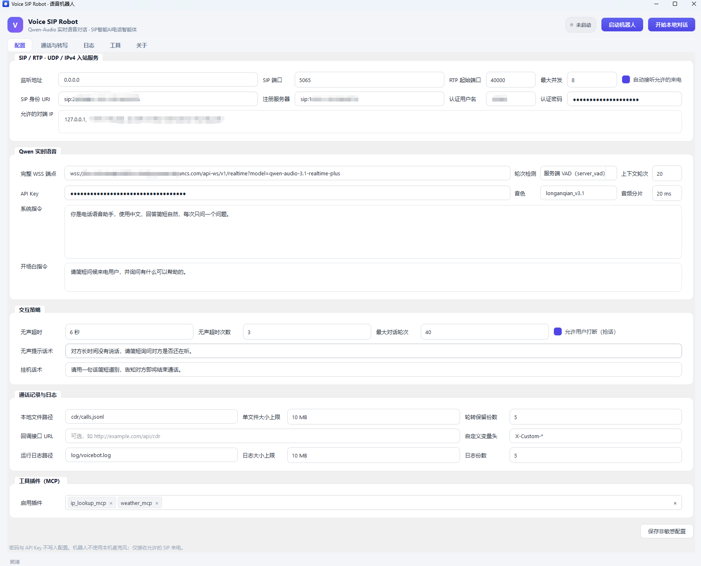
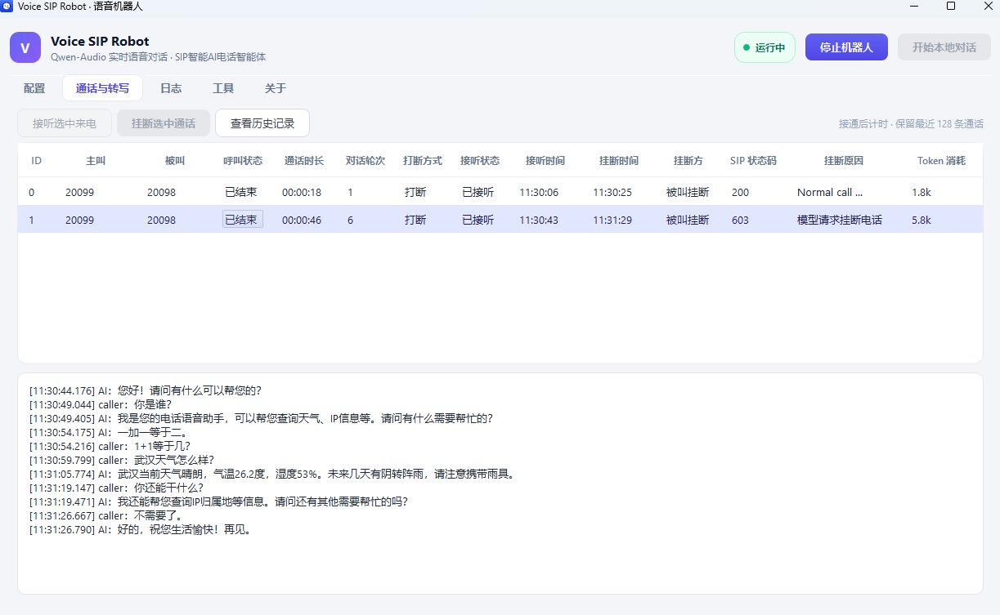
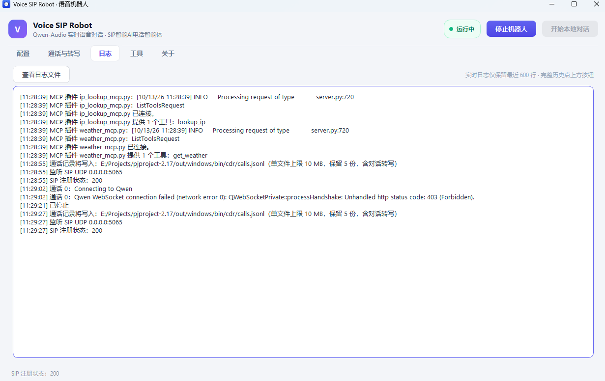
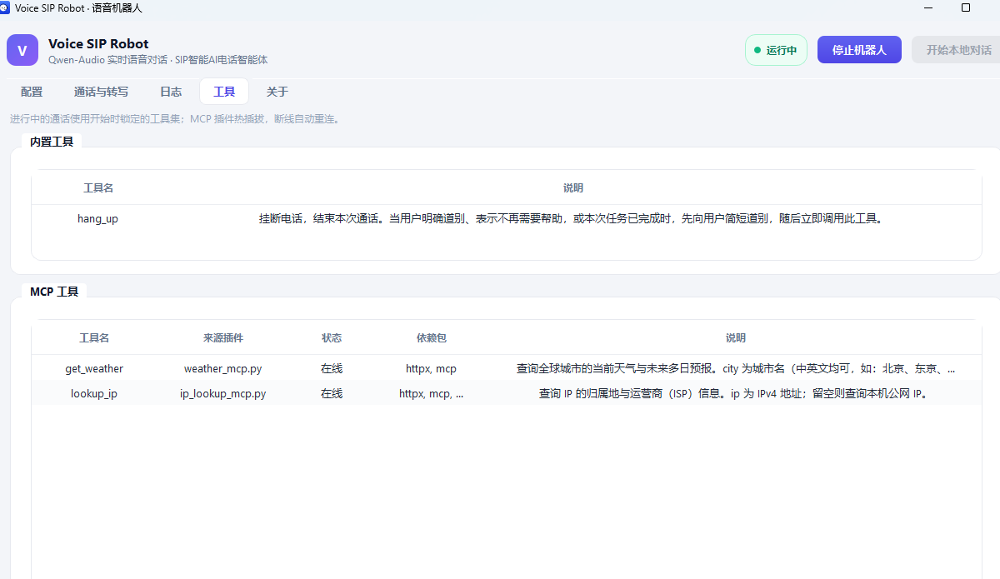

# Voice SIP Robot（voicebot）

基于 PJSIP + 阿里 Qwen 实时语音大模型的电话 AI 机器人。通过 SIP 协议接入 FreeSWITCH/PBX 实现电话呼入应答，将通话音频实时桥接至大模型完成智能语音交互，支持 Function Calling 工具扩展（内置挂断工具 + MCP 插件体系），同时提供本地麦克风对话模式用于无 SIP 环境下的功能验证。

## 系统架构

```
FreeSWITCH/PBX ──SIP/RTP──► PJSIP（pjsua2）
                                │  PCM 8kHz
                          PcmBridge（重采样/缓冲）
                                │  PCM 16kHz
                          QwenSession（Qt WebSocket）
                                │  WSS（TLS）
                        阿里 Qwen 实时全双工模型
                                │  function_call
                ToolRegistry ──┬─ 内置工具（hang_up，进程内）
                               └─ MCP 插件（stdio 子进程）
```

本地对话模式：麦克风/扬声器替代 SIP/RTP 链，其余一致。

## 主要功能

- **SIP 通话接入**：注册/免注册模式、对端白名单（IPv4/CIDR）、自动应答、单实例最大 180 路并发
- **Qwen 实时全双工模型对接**：WSS 加密传输、smart_turn VAD 轮次检测、音色/系统指令/开场白可配
- **交互策略**：无声超时提示+挂断、最大对话轮次、全双工打断（抢话）、挂机话术完整播放
- **提示词变量注入**：支持 `{{X-Custom-Name}}` 占位符，按来话 INVITE 自定义 SIP 头值做每通话替换
- **Function Calling 工具**：内置挂断工具 + MCP 插件扩展、热插拔不影响进行中通话
- **通话记录**：JSONL 含逐句对话转写 + Token 用量统计、Webhook 回调
- **跨平台**：Windows / Linux（GUI + 无头模式）


 

 


## 下载预编译包（推荐，免编译）

从 [Releases](../../releases) 页面下载对应平台的安装包：

### Windows

1. 下载 `voicebot-1.0.0-win64.zip`，解压到任意目录
2. 复制 `voicebot.ini.default` 为 `myconfig.ini`，修改配置项
3. 设置密钥环境变量，运行：

```powershell
$env:DASHSCOPE_API_KEY = "sk-xxx"
$env:QWENBOT_SIP_PASSWORD = "your-password"
.\bin\voicebot.exe            # GUI 模式
.\bin\voicebot.exe --headless --config myconfig.ini  # 无头模式
```

> Windows 包含全部 Qt DLL，解压即用，无需安装额外依赖。

### Linux

1. 下载 `voicebot-1.0.0-Linux.tar.gz`，解压到任意目录
2. 安装 Qt6 运行库（Ubuntu 24.04 示例）：

```bash
sudo apt install libqt6widgets6t64 libqt6network6t64 libqt6websockets6 \
                 libqt6multimedia6 libgl1
```

3. 复制配置模板并修改，设置密钥，运行：

```bash
cp voicebot.ini.default myconfig.ini
vim myconfig.ini
export DASHSCOPE_API_KEY="sk-xxx"
export QWENBOT_SIP_PASSWORD="your-password"
./bin/voicebot --headless --config myconfig.ini
```

### MCP 插件（可选）

如需天气查询、IP 归属地等 MCP 工具功能：

```bash
# Python ≥3.10 + 依赖（mcp 版本必须 <2）
pip install "mcp[cli]<2" httpx
```

配置文件中启用插件：

```ini
[tools]
enabledPlugins = weather_mcp.py, ip_lookup_mcp.py
```

## 使用方式

### 1. SIP 模式

**本地已注册 SIP 账号**：voicebot 已在上游 FreeSWITCH/PBX 注册，由上游发起呼叫：

```
originate {absolute_codec_string=PCMA}sofia/gateway/用户手机号 &bridge(user/sip账号)
```

**本地无 SIP 注册账号**（免注册模式）：

```
originate {absolute_codec_string=PCMA}sofia/gateway/用户手机号 &bridge(sofia/external/xxx@ip)
```

### 2. 本地对话模式

填写阿里大模型信息后，直接点击右上角「开始本地对话」，即可与机器人进行交互。

## 从源码构建

需要 CMake ≥3.28、C++17 编译器、Qt 6（Windows ≥6.5，Linux ≥6.4）。

**Windows**（PowerShell，需 MSVC + Qt SDK）：

```powershell
cmake -S pjsip-apps/src/voicebot -B out/windows/build -DCMAKE_BUILD_TYPE=Release
cmake --build out/windows/build --config Release --target voicebot
cmake --install out/windows/build --config Release --prefix out/windows
```

**Linux**：

```bash
cmake -S pjsip-apps/src/voicebot -B out/linux/build -DCMAKE_BUILD_TYPE=Release
cmake --build out/linux/build -j --target voicebot
cmake --install out/linux/build --prefix out/linux
```

> Windows 构建后必须执行 `cmake --install`，windeployqt 会打包 Qt DLL。

## 配置说明

配置优先级：`--config <path>` > `VOICEBOT_CONFIG` 环境变量 > 系统原生 QSettings（Windows 注册表 / Linux ~/.config/）

完整配置项详见 [voicebot.ini.default](pjsip-apps/src/voicebot/voicebot.ini.default)（带中文注释）。

密钥支持环境变量和配置文件两种方式（优先级：环境变量 > 配置文件）：

| 环境变量 | 说明 |
|---|---|
| `DASHSCOPE_API_KEY` | 阿里 API Key（优先级高于配置文件 `qwen/apiKey`） |
| `QWENBOT_SIP_PASSWORD` | SIP 注册密码（优先级高于配置文件 `sip/password`） |
| `VOICEBOT_CONFIG` | 指定配置文件路径 |
| `VOICEBOT_PLUGINS_DIR` | 覆盖插件目录（默认 `<exe>/../plugins`） |

## 交流

- QQ：736984328
- QQ 群：482489124
- GitHub：[feiyonggao/voice-sip-robot](https://github.com/feiyonggao/voice-sip-robot)

## 许可证

本项目基于 [PJSIP](https://github.com/pjsip/pjproject)（GPL-2.0）构建，衍生作品同样采用 GPL-2.0 许可证。许可证文本见 [COPYING](COPYING)。如需闭源商业使用，请获取 PJSIP 商业许可证。

## 致谢

- [PJSIP](https://github.com/pjsip/pjproject) — SIP/RTP 多媒体通信库
- [Qt](https://www.qt.io/) — 跨平台 GUI 框架
- [阿里 Qwen 实时全双工模型](https://docs.bailian.console.aliyun.com/zh/model-studio/qwen-audio-realtime-user-guides#fc60h313) — 语音实时对话大模型
- [MCP](https://modelcontextprotocol.io/) — Model Context Protocol
- [Open-Meteo](https://open-meteo.com/) — 免 API Key 天气数据
- [ip-api.com](https://ip-api.com/) / [ipwho.is](https://ipwho.is/) — IP 归属地查询
